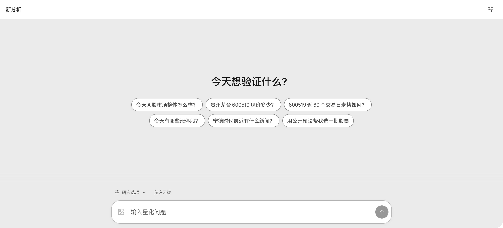

# RiQi

<a href="https://riqi.ai/">
  <picture>
    <source media="(prefers-color-scheme: dark)" srcset="https://reachrich.ai/icons/riqi-dark-180.png">
    
  </picture>
</a>

RiQi 是 [ReachRich](https://github.com/reachrich-ai/reachrich) 的 AI 投研助手，面向 A 股公司与市场研究。提供问题和相关资料，在同一个会话中梳理信息、讨论不同解释，并随着新材料补充和修正判断。

[打开 RiQi](https://riqi.ai/) · [产品介绍](https://reachrich.ai/riqi) · [使用手册](https://docs.reachrich.ai/) · [English](README.en.md)

<picture>
  <source media="(prefers-color-scheme: dark)" srcset="riqi-workspace-dark.png">
  
</picture>

<sub>RiQi 新分析工作区。提出市场问题、附上研究资料，并按需要调整研究选项。</sub>

## 快速开始

1. 打开 RiQi，按提示登录，进入“新分析”。
2. 说明公司、报告期和研究问题，提供希望讨论的资料。
3. 阅读回答，核对数字与出处；围绕具体依据继续追问。

例如，将相关年报内容与这个问题一起提供：

```text
请根据我提供的年报资料，
比较收入与经营现金流变化。

范围：最近两个报告期。
列出数值、单位和出处，
说明两者的变化是否一致。
区分报告事实与分析，
列出还需核实的问题。
```

进一步追问：“应收账款的变化能否解释现金流差异？请指出对应资料，并说明还有哪些解释需要排查。”

## 继续你的研究

- **整理公司资料**：明确公司、期限与核心问题，把公告和报告出处留在研究记录中。[公司研究流程](https://docs.reachrich.ai/workflows/company-study.html)
- **检查回答依据**：核对报告期、数字、引用与假设，分清资料披露的事实和分析解释。[阅读回答](https://docs.reachrich.ai/riqi/read-answer.html)
- **补充材料与追问**：针对回答中的某个判断继续问，比较不同解释，逐步收敛问题。[追问与修正](https://docs.reachrich.ai/riqi/follow-up.html)
- **回到原会话**：有了新公告或新报告，补充日期与变化，接着此前的研究继续。[会话指南](https://docs.reachrich.ai/riqi/history.html)

更多问题写法见[提问指南](https://docs.reachrich.ai/riqi/ask.html)。需要先查看行情、检索资讯或建立候选清单，可从 [ReachRich](https://reachrich.ai/) 开始。

## 研究指南

- [用 RiQi 做 A 股公司研究](https://riqi.ai/research/a-share-company-research.html)：从公司公告到持续追问的完整示例。
- [因子验证与样本外研究](https://reachrich.ai/research/a-share-factor-validation.html)：记录研究尝试，检查过拟合与验证区间。

## 文档与支持

[完整手册](https://docs.reachrich.ai/) · [登录与账号](https://docs.reachrich.ai/start/login.html) · [功能访问](https://docs.reachrich.ai/help/access.html) · [问题反馈](https://reachrich.ai/support)

当前以 A 股研究为主，功能按账号权限提供。本仓库维护产品介绍与公开指南，软件服务通过官网使用。

**Powered by ReachRich**
